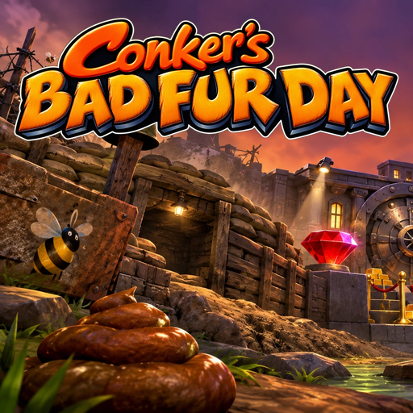

# Conker's Bad Fur Day: Recompiled for the PS5

<p align="center"></p>

A port of [Conker's Bad Fur Day: Recompiled](https://github.com/sciaschi/CBFD-Recompiled) (V0.1.6) to the PS5 as
native homebrew: 4K widescreen, 60 fps, texture packs, and a menu made for the DualSense. It runs as an installed
title (`PPSA64065`) and renders with RT64 through Vulkan on [Mihawk's RADV port](https://github.com/mihawk-99/PS5_Vulkan).

Unofficial, and not affiliated with or endorsed by Rare, Microsoft, Nintendo or Sony.

**This repository and its releases contain no game assets. You need your own Conker's Bad Fur Day (USA) ROM.**

## What you need

- A PS5 that runs homebrew (an enabler such as etaHEN) with **ShadowMountPlus**, which puts homebrew on the home
  screen. Tested on firmware 13.60.
- **Your own Conker's Bad Fur Day ROM**, the USA version: SHA-1 `4cbadd3c4e0729dec46af64ad018050eada4f47a` as
  `.z64` (`.n64` and `.v64` dumps are converted). ROM hacks that only change the game's assets (such as an
  uncensored one) are accepted too; hacks that change its code aren't.

## Installing

1. Download `PPSA64065.zip` from the [latest release](../../releases/latest) and extract it into a folder
   ShadowMountPlus scans: `/data/homebrew/` on the console's storage, or `homebrew/` on a USB drive or M.2 storage.
2. Put your ROM in the `PPSA64065` folder, next to `eboot.bin`. Any file name works.
3. Let ShadowMountPlus register the title, then start **Conker's Bad Fur Day** from the home screen.

On the first start the game checks the ROM and keeps its own copy (`conker.n64.us.1.0.z64`), which takes about ten
seconds behind the splash; after that the game starts in under a second, and the file you added can be removed.
Without a usable ROM the game says where to put it, and why a ROM file it found was refused.

**Press the touchpad** to open the game's menu: settings, controls, sound, achievements and mods. Quit from the
menu's top right corner.

**Updating**: copy the new `PPSA64065` folder over the old one, merging it. Your saves (`saves/`), settings (the
`.json` files), added mods and texture packs (`mods/`) and the ROM copy are kept: a release contains none of them.

## Texture pack (recommended)

Three community texture packs, merged into one file ready to copy to the console, are in
[CBFD-Recompiled-PS5-Texture-Pack](https://github.com/Samclay8/CBFD-Recompiled-PS5-Texture-Pack), with full credit
to their authors (none is included in this release: they're their authors' work):

- **4K Ultimate Texture Pack** by GameBeast92, a work in progress: the characters, title, intro, HUD and menus, and
  parts of several chapters and the multiplayer maps, redrawn in 4K. Its newest builds appear first in
  [GameBeast92's Discord](https://discord.gg/up8wah5hFu).
- **HD Icons** by dahmedvall95, from GameBeast92's artwork (CC BY 4.0): the pictures the 4K pack doesn't have yet,
  mostly the speech bubbles' letters.
- **AI Upscale** by Nikachu (2022), from [N64Textures](https://www.n64textures.com/downloads/?lang=en): nearly every
  other texture, upscaled.

**[Download CBFD-PS5-Texture-Pack.rtz](https://github.com/Samclay8/CBFD-Recompiled-PS5-Texture-Pack/releases/latest/download/CBFD-PS5-Texture-Pack.rtz)**
(about 450 MB), copy it into the `mods` folder inside `PPSA64065` (the game makes it on its first start), and switch
on **4K + HD Icons + AI Upscale** under **Mods** in the menu. Each texture comes from the first of the three that has
it, so there's no order to set.

With more than one pack, the one higher in the **Mods** list is generally used where two replace the same picture.
A newly added pack goes to the top. To move one, select it, press Triangle, move it with the D-pad and press Triangle
again.

Other packs work too: RT64 `.rtz` packs as they are, and GLideN64 packs (`.htc`, or a folder of Rice-named `.png`
files) after converting them on a PC with this repository's [`tools/gliden64_to_rt64.py`](tools/gliden64_to_rt64.py)
(Python 3):

```sh
python gliden64_to_rt64.py "PACK_HIRESTEXTURES.htc" --out pack --name "Pack name" --author "Author" --rtz pack.rtz
```

## Mods

Two of Conker's Bad Fur Day: Recompiled's own mods, Skip Intro and Skip Any Cutscene, are built in as one setting,
**Skip Cutscenes** on the **General** tab: **Off** (the default, as the game was), **Intro Only** (start at the bar, a
button press from the main menu) or **All** (that, and L1 skips any cutscene, even the first time).

Other code mods (`.nrm`) made for Conker's Bad Fur Day: Recompiled load from `mods/` too, such as its Cheats
([V0.1.6 mods](https://github.com/sciaschi/CBFD-Recompiled/releases/tag/V0.1.6)). They haven't been tested on the
console yet. A code mod can't change while the game runs: its switch asks to close the game, and the change applies
when it is started again.

## What's different on the PS5

- The game starts straight away, with no launcher: the ROM comes from the title folder. The launcher is only the
  ROM screen, when no usable ROM is found.
- 4K output, the game's 30 fps interpolated to 60 (Framerate **Original** keeps 30).
- A menu for the console: PlayStation button prompts, and no options that only make sense on a PC (window, mouse,
  keyboard, gyro, the rumble motor and style). Texture packs are switched in the **Mods** menu only, and are put in
  order there with the controller (Triangle, the D-pad, Triangle) rather than by dragging with a mouse.
- A **Performance Overlay** option (Graphics tab): frame rate, a frame-time graph and memory, in place of the PC
  version's Show FPS.
- A **Skip Cutscenes** setting (General tab: Off by default, Intro Only, All), so the Skip Intro and Skip Any
  Cutscene mods needn't be installed.
- Pausing freezes the picture as it was, in 4K across the whole screen, without the game's blur. The blur is done
  by the N64's CPU at the N64's resolution and 4:3, so in widescreen the PC version zooms that copy up to fill the
  screen, and it jumped from the sharp picture to the blurred one as the game paused.
- `conker.log` in the title folder records the start-up, errors and crash reports, with the previous session's
  log kept as `conker.prev.log`. Please include them when reporting a problem.

## Known issues

- Save states (F5 and F7 on a PC) aren't available: there's no keyboard.
- The PC launcher's Version and Add ROM options (switching between ROM hacks) aren't there: an asset-only ROM hack
  works when it's the only ROM in the folder.
- The console reports a second controller device ("PS5 Remote Control") beside the DualSense. It only takes a
  player slot if it presses a button, so it doesn't affect play.

## Building

On Linux (here: a dedicated Ubuntu 26.04 WSL distro, no Docker). Building needs the ROM too, as the game's code is
generated from it:

```sh
setup/wsl-packages.sh                                       # as root, once: compilers and build tools
setup/fetch-sources.sh                                      # once: all sources at pinned commits
tools/setup-source.sh "Conker's Bad Fur Day (USA).z64"      # apply patches/, generate the game code from the ROM
./build.sh radv                                             # once: RADV, the payload SDK fork, the title converter
./build.sh configure
./build.sh
tools/package.sh                                            # dist/PPSA64065, without a ROM
```

`build.sh` runs everything through `tools/run.sh` directly, not in a container. Never publish a build together
with a ROM, or with anything else from the game.

The home screen art comes from `assets/` (a Python venv with `pillow` and `etcpak`):

```sh
python tools/make-art.py assets/background-source.webp build-art assets/logo-source.webp
python tools/make-backgrounds.py build-art/background.png build-art/splash.png sce_sys
```

### What the port changes

| File | Change |
| --- | --- |
| `patches/conker.patch` | CBFD-Recompiled's own tree: the ROM from the title folder, with the launcher only as the ROM screen (its picture, the logo fading in, Exit selected only after a first press); a 3840x2160 window without SDL Vulkan; PS5 start-up and log; Conker's TLB-mapped code pages backed by their own direct memory; no working-directory calls; PS5 libraries in CMake; the PC-only options hidden; old-format GLideN64 packs in the pack converter |
| `patches/tools__N64ModernRuntime.patch` | N64 memory from a kernel reservation backed by direct memory, thread names, an exit the console allows, code mod switches that apply on the next start, and save states' stack signatures walked with the unwinder (`backtrace()` ends a PS5 title) |
| `patches/tools__N64ModernRuntime__N64Recomp*.patch` | The mod recompiler's per-thread state, and executable memory the console allows (sljit) |
| `patches/tools__rt64.patch` | Host-built `file_to_c`, a file dialog stub, PS5 threads and window, the performance overlay, the start-up splash kept up until the first frame, and Rice texture matching by CRC alone for old GLideN64 packs |
| `patches/tools__rt64__src__contrib__plume.patch` | Presenting through `VK_KHR_display` |
| `patches/tools__RecompFrontend.patch` | Title folder paths, the touchpad opens the menu, 60 Hz display, the Performance Overlay option, a menu for the console (PlayStation button glyphs, Framerate as Original (30) or 60, no options for a window, downsampling, mouse, gyro, background input or keyboard, or for installing mods from the menu), code mod switches for the next start |
| `ps5/` | Start-up, log and crash reports, relative paths, libc shims, title linking |
| `tools/`, `setup/` | Building, packaging, the art, and `gliden64_to_rt64.py` (a copy of CBFD-Recompiled's pack converter with old-format support) |

## Licences and credits

This repository's own files are licensed under GPL-3.0-or-later ([LICENSE](LICENSE)). A built title links GPL-3.0
code (N64ModernRuntime, RecompFrontend, Mihawk's PS5 layer) and GPL-2.0-or-later code (RT64's Rice texture
matching), so the title is a GPL-3.0 combined work; [LICENSES.txt](LICENSES.txt), which the release includes, lists
them.

- **[Conker's Bad Fur Day: Recompiled](https://github.com/sciaschi/CBFD-Recompiled)** by sciaschi, with nitrostemp
  and contributors: MIT. Its pack converter, `tools/gliden64_to_rt64.py` here, is too.
- **[Conker's Bad Fur Day decompilation](https://github.com/mkst/conker)**, which CBFD-Recompiled is built on
- **[N64Recomp](https://github.com/N64Recomp/N64Recomp)** (MIT),
  **[N64ModernRuntime](https://github.com/N64Recomp/N64ModernRuntime)** (GPL-3.0) and
  **[RecompFrontend](https://github.com/N64Recomp/RecompFrontend)** (GPL-3.0) by Wiseguy and contributors
- **[RT64](https://github.com/rt64/rt64)** by Darío and contributors: MIT, with CBFD-Recompiled's Rice texture
  matching under GPL-2.0-or-later (after GlideHQ by Hiroshi Morii and Rice Video)
- **[PS5 Vulkan (RADV) port](https://github.com/mihawk-99/PS5_Vulkan)** and its payload SDK fork by Mihawk:
  GPL-3.0-or-later, on the [ps5-payload-dev](https://github.com/ps5-payload-dev) SDK and Mesa (MIT)
- **[Wave Race 64 PS5 port](https://github.com/Marice/wave-race-64-ps5)** by Marice (GPL-3.0-or-later), and
  **[DK64 Rekongpiled for the PS5](https://github.com/Samclay8/DK64-Rekongpiled-PS5)**, which this port's PS5 layer
  and library patches come from
- **PacBrew ports** (SDL2, FreeType and their libraries) by the ps5-payload-dev contributors, under their own
  permissive licences
- **RmlUi**, **lunasvg**, **Dear ImGui**: MIT. **Inter**, **Noto Emoji**, **PromptFont**: SIL Open Font Licence
- Home screen art and logo by Samclay8, made with ChatGPT
- Texture packs (not included; merged in
  [CBFD-Recompiled-PS5-Texture-Pack](https://github.com/Samclay8/CBFD-Recompiled-PS5-Texture-Pack)): **GameBeast92**'s
  [4K Ultimate Texture Pack](https://github.com/GameBeast92/Conker-s-Bad-Fur-Day-4k-Ultimate-Texture-Pack)
  (CC BY 4.0 on GitHub; newest build in [his Discord](https://discord.gg/up8wah5hFu)), **HD Icons** by dahmedvall95
  from GameBeast92's artwork, and **Nikachu**'s [AI Upscale](https://www.n64textures.com/downloads/?lang=en)

Conker's Bad Fur Day is © Rare Ltd. "PlayStation" and "PS5" are trademarks of Sony Interactive Entertainment. This
project is not affiliated with or endorsed by Rare, Microsoft, Nintendo or Sony.
